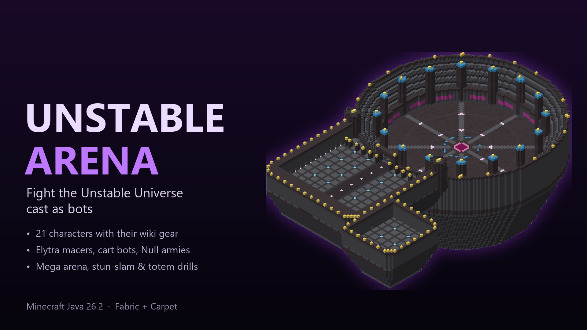

# Unstable Arena

A Minecraft PvP map where the Unstable Universe cast are bots you can fight.
Minecraft Java **26.2** - Fabric + Carpet.

## Downloads

| | |
|---|---|
| **Unstable Arena (the map)** | [Get it on Patreon](https://www.patreon.com/Cinhgang) |
| **Fabric Loader** (required) | [fabricmc.net/use/installer](https://fabricmc.net/use/installer/) |
| **Carpet** (required) | [modrinth.com/mod/carpet](https://modrinth.com/mod/carpet) |
| **Fast Bots** (optional, for big bot armies) | [Download](https://github.com/cinhgang-a11y/fast-bots/releases/latest) |

## Install
1. Install Fabric Loader for Minecraft 26.2.
2. Put Carpet (and Fast Bots if you want it) in your `mods` folder.
3. Unzip the map and move the `Unstable Arena` folder into your `saves` folder.
4. Start the game and open **Unstable Arena**. If the bots don't respond, type `/script load pvpbot`.

Made by **redishpurple**.
